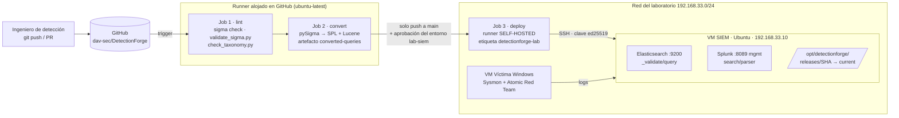

# Pipeline CI/CD de DetectionForge

Pipeline *Detection-as-Code* que valida, convierte y verifica reglas Sigma en cada
cambio, y despliega una *release* versionada en la VM SIEM. **Estado: completo**
(ejecución real de punta a punta tras el merge a `main`).

## 1. Arquitectura y topología



| Etapa | Dónde corre | Cuándo | Falla si… |
|---|---|---|---|
| lint | GitHub | PR y push a `main` | YAML, tags ATT&CK o taxonomía inválidos |
| convert | GitHub | PR y push a `main` | una regla no convierte a SPL o Lucene |
| deploy | Runner self-hosted → SSH | solo push a `main`, con aprobación | SSH falla, un SIEM está caído o rechaza una consulta |

**Por qué un runner self-hosted.** `192.168.33.10` es una IP privada y los runners de GitHub
no pueden alcanzarla. El job `deploy` corre en un runner propio con las etiquetas
`self-hosted`, `linux` y `detectionforge-lab`.

**Dónde corre el runner.** Durante el desarrollo se validó con el runner en una VM Kali
(WSL2 no tenía ruta a la red de las VMs). En la configuración final el runner está
instalado como servicio `systemd` en la VM SIEM, por lo que el paso SSH conecta con la
propia VM por su IP. Funciona igual; los compromisos de esa elección son que el runner
comparte RAM con Elasticsearch y Splunk y que ejecuta código del repositorio dentro del
SIEM. Una VM auxiliar o el host eliminan ambos problemas y no requieren cambios en el
workflow (solo registrar el runner con la misma etiqueta).

**Alcance.** El CI verifica sintaxis y que ambos SIEM aceptan las consultas. No prueba que
detecten el ataque: eso es la validación empírica del Entregable 3 (atomic test y
`runner/runner.py`), que sigue siendo previa a mover una regla a `rules/production/`.

## 2. Estructura del repositorio (archivos de este entregable marcados con ★)

```
DetectionForge/
├── .github/
│   ├── workflows/
│   │   └── detection_pipeline.yml     ★ pipeline CI/CD
│   ├── CODEOWNERS
│   └── pull_request_template.md
├── docs/
│   ├── taxonomia-estandares.md
│   ├── laboratorio-setup.md
│   ├── Piloto end-to-end.md
│   ├── Pipeline_CICD.md           ★ este documento
│   ├── coverage/                      (Entregable 5)
│   │   └── README.md
│   │   └── attack-navigator-layer.json
│   │   └── coverage-report.md
│   └── evidencia/
├── rules/
│   ├── staging/
│   └── production/
├── runner/                            (Entregable 3)
├── scripts/
│   ├── validate_sigma.py              ★ lint YAML + tags ATT&CK + taxonomía
│   ├── ci/
│   │   └── verify_siem.py             ★ se ejecuta en la VM SIEM
│   ├── check_taxonomy.py              (ajustado: multi-documento y correlaciones)
│   ├── generate_coverage.py           (Entregable 5)
│   ├── convert_all.sh
│   └── strip_custom_fields.py
├── requirements.txt
└── build/                             (generado; en .gitignore)
```

## 3. Scripts

### 3.1 `validate_sigma.py`

```bash
python3 scripts/validate_sigma.py rules/staging rules/production
python3 scripts/validate_sigma.py rules/staging/<regla>.yml --warn-as-error
```

Comprueba: YAML válido (multi-documento), campos obligatorios, `id` UUID y único,
`logsource` y `detection` (o `correlation`), `status` y `level` válidos, al menos una
táctica y una técnica ATT&CK con formato correcto, ausencia de enlaces a
`attack.mitre.org` en `references`, bloque `detectionforge`, y los requisitos de
`production` (`status: stable` y `validation_status: passed`). Emite anotaciones de
GitHub (`::error file=…`).

Decisiones de diseño que salieron de las pruebas con las reglas reales:
- **Tácticas:** acepta guion y guion bajo (`credential-access` y `credential_access`) e
  incluye las de ATT&CK v18 (`stealth`, `defense-impairment`) además de `defense_evasion`
  por compatibilidad. La lista debe revisarse cuando ATT&CK publique cambios.
- **Correlaciones:** en un archivo multi-documento, la regla base referenciada por una
  correlación se trata como auxiliar y solo se le exigen los campos estructurales; los
  tags, `level` y `detectionforge` se exigen a la regla de correlación. La comprobación de
  `references` aplica a todos los documentos.

### 3.2 `check_taxonomy.py`

Se ajustó para leer varios documentos por archivo (`yaml.safe_load_all`), validar la regla
de correlación como principal y no exigirle `logsource` ni `detection`. Sin este ajuste
fallaba con `expected a single document in the stream` en T1046 y T1110.

### 3.3 `verify_siem.py`

Se ejecuta en la VM SIEM. Comprueba la salud de Elasticsearch y Splunk y valida la sintaxis
de cada consulta sin ejecutarla (`_validate/query` en Elastic y `search/parser` en Splunk).

## 4. Puesta en marcha (una sola vez)

### 4.1 VM SIEM
```bash
sudo mkdir -p /opt/detectionforge/releases && sudo chown -R sebastian: /opt/detectionforge
python3 --version
sudo ss -tlnp | grep -E '8089|9200'     # Splunk (gestión) y Elasticsearch escuchando
```

### 4.2 Clave SSH dedicada
```bash
ssh-keygen -t ed25519 -f ~/.ssh/detectionforge_ci -C "detectionforge-ci" -N ""
ssh-copy-id -i ~/.ssh/detectionforge_ci.pub sebastian@192.168.33.10
ssh -i ~/.ssh/detectionforge_ci -o BatchMode=yes sebastian@192.168.33.10 'echo OK'
ssh-keyscan -t ed25519 192.168.33.10          # → secreto SIEM_KNOWN_HOSTS (una sola línea)
base64 -w0 ~/.ssh/detectionforge_ci; echo     # → secreto SIEM_SSH_KEY_B64
```
La clave privada se almacena **en base64** porque pegarla en el navegador corrompió el
formato y SSH rechazaba el archivo (`error in libcrypto`).

### 4.3 Runner self-hosted
*Settings → Actions → Runners → New self-hosted runner* (Linux x64). Es imprescindible
registrarlo con la etiqueta, o el job `deploy` se queda en cola indefinidamente:
```bash
./config.sh --url https://github.com/dav-sec/DetectionForge --token <TOKEN> --labels detectionforge-lab
sudo ./svc.sh install <usuario> && sudo ./svc.sh start && sudo ./svc.sh status
```
Si el runner ya existe sin la etiqueta, se añade desde la página del runner (*Edit labels*)
o se reconfigura con `./config.sh remove` y de nuevo `config.sh --labels …`.

### 4.4 Entorno de GitHub
*Settings → Environments → `lab-siem`*: *Required reviewers* (dav-sec o Manzur68) y
despliegue restringido a la rama `main`. Para repositorios públicos, exigir aprobación de
workflows de forks (*Settings → Actions → General*).

## 5. Secretos de GitHub

*Settings → Environments → lab-siem → Environment secrets*:

| Secreto | Valor | Uso |
|---|---|---|
| `SIEM_HOST` | IP de la VM SIEM (`192.168.33.10`) | destino SSH |
| `SIEM_USER` | usuario SSH (`sebastian`) | usuario SSH |
| `SIEM_SSH_KEY_B64` | clave privada en **base64** (`base64 -w0`) | autenticación |
| `SIEM_KNOWN_HOSTS` | salida de `ssh-keyscan -t ed25519 <ip>`, una línea | evita MITM |
| `ELASTIC_PASSWORD` | contraseña del usuario `elastic` | `_validate/query` |
| `SPLUNK_USER` | usuario de Splunk | `search/parser` |
| `SPLUNK_PASSWORD` | contraseña de Splunk | `search/parser` |

Los nombres deben coincidir exactamente: un error de una letra deja el valor vacío sin
avisar. No se almacenan credenciales en el repositorio ni en la documentación. Se recomienda
usar para el CI una cuenta de Splunk y otra de Elastic con permisos mínimos y rotar las
credenciales y la clave periódicamente.

## 6. Resultado

Ejecución tras el merge a `main`: `lint`, `convert` y `deploy` en verde. La conversión
generó 19 archivos SPL y 18 archivos Lucene (las dos reglas de correlación solo se
convierten a Splunk). `deploy` subió la release, validó las consultas en ambos SIEM y
activó el enlace `/opt/detectionforge/current`. Evidencia en `docs/evidencia/`.

## 7. Guía de mantenimiento

**Operación diaria.** Flujo: rama → regla en `rules/staging/` → PR → `lint` y `convert`
verdes → merge → aprobación del entorno → `deploy`. El artefacto `converted-queries`
guarda las consultas generadas (30 días). En la SIEM se conservan las 10 últimas releases
en `/opt/detectionforge/releases/<sha>`.

**Rollback.**
```bash
ln -sfn /opt/detectionforge/releases/<sha_anterior> /opt/detectionforge/current
```
o `git revert` y nuevo push.

**Diagnóstico** (los marcados con ★ ocurrieron durante la puesta en marcha):

| Síntoma | Causa probable | Solución |
|---|---|---|
| ★ `deploy` en *Queued* aunque el runner está *Idle* | el runner no tiene la etiqueta `detectionforge-lab` | añadir la etiqueta; luego *Re-run* del workflow |
| `deploy` en cola y runner *Offline* | servicio o proceso del runner detenido | `sudo ./svc.sh status` / `start` |
| ★ `No ED25519 host key is known … strict checking` | `SIEM_KNOWN_HOSTS` vacío o incorrecto | regenerar con `ssh-keyscan -t ed25519 <ip>` y pegar solo esa línea |
| ★ `Load key … error in libcrypto` | clave privada corrompida al copiarla | usar `SIEM_SSH_KEY_B64` con `base64 -w0` |
| `Permission denied (publickey)` | clave pública no autorizada en la SIEM | repetir `ssh-copy-id` |
| ★ `lint`: *falta tag de táctica* / *formato inválido* en `attack.credential-access` | validador sin soporte de guiones o de tácticas ATT&CK v18 | usar la versión actual de `validate_sigma.py` |
| ★ `check_taxonomy`: `expected a single document` | regla de correlación (multi-documento) | usar la versión actual de `check_taxonomy.py` |
| `lint`: `level` no permitido | valor fuera de la taxonomía (p. ej. `informational`) | usar `low`, `medium`, `high` o `critical` |
| `convert` falla en una regla | campo sin mapeo en el pipeline | probar `sigma convert …` en local; revisar `sigma list pipelines` |
| Splunk HTTP 0 / refused en `verify_siem.py` | puerto de gestión distinto de 8089 o servicio parado | `ss -tlnp \| grep splunkd`; ajustar `SPLUNK_URL` |
| Elastic HTTP 401 | contraseña rotada | actualizar `ELASTIC_PASSWORD` |
| WSL2 no alcanza `192.168.33.10` | red NAT de WSL distinta de la de las VMs | usar una VM (o el host) como runner |

**Mantenimiento periódico.**
- Mensual: actualizar dependencias (`pip install -U sigma-cli pysigma-*`, `sigma plugin
  install …`), probar en una rama y fijar versiones.
- Cuando ATT&CK publique una versión nueva: revisar la lista de tácticas de
  `validate_sigma.py`.
- Trimestral: rotar la clave SSH y las contraseñas de los SIEM; revisar versiones de las
  acciones de GitHub (fijadas a versión mayor).
- Al reimportar la VM SIEM: confirmar que conserva la IP y que `SIEM_KNOWN_HOSTS` sigue
  siendo válido; si cambió la clave de host, regenerar el secreto.
- Para añadir Sentinel (fase 2): un paso nuevo en `convert`, el plugin correspondiente de
  pySigma y un verificador propio en `scripts/ci/`.
